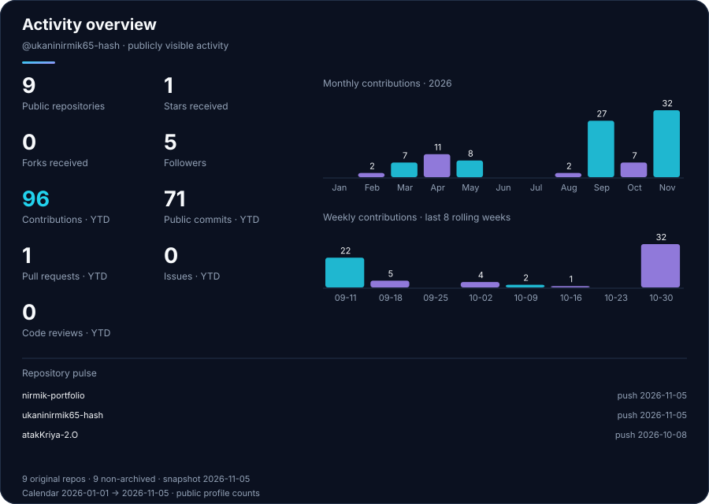
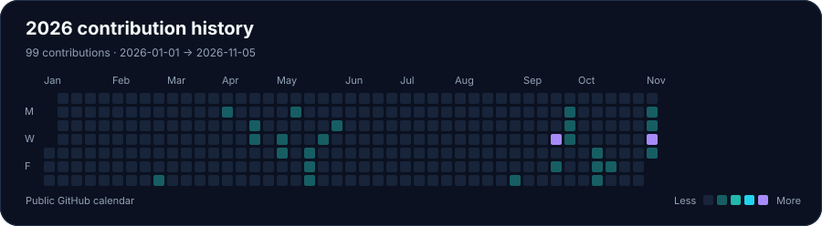
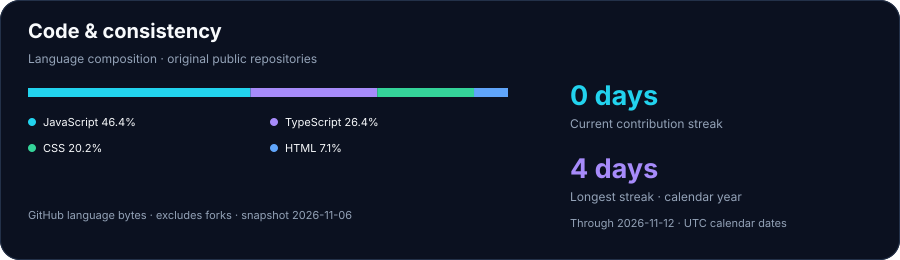

  
  

  <a href="#about">About</a> &nbsp;·&nbsp;
  <a href="#tech-stack">Tech Stack</a> &nbsp;·&nbsp;
  <a href="#projects">Projects</a> &nbsp;·&nbsp;
  <a href="#experience">Experience</a> &nbsp;·&nbsp;
  <a href="#github-activity">GitHub Activity</a> &nbsp;·&nbsp;
  <a href="#freelance-services">Freelance Services</a> &nbsp;·&nbsp;
  <a href="#contact">Contact</a>

  

<em>Thoughtful interfaces. Reusable components. Details that make the web easier to use.</em>

## About

I'm **Nirmik Ukani**, a **Frontend Developer with 1+ year of hands-on experience** building responsive, interactive web interfaces with **React.js and JavaScript**. I turn UI designs into reusable components, with attention to accessibility, performance, and maintainable code.

**Current focus** — Deepening my React knowledge, learning TypeScript and Next.js, and improving how I structure modern frontend applications.

## Tech Stack

**Frontend** · HTML5 / CSS3 / JavaScript / React.js  

**Styling** · Bootstrap / Tailwind CSS  

**Tools** · Git / GitHub / VS Code / Vite  

**Currently learning** · TypeScript / Next.js  

## Projects

Selected work across application interfaces, browser interaction, and responsive websites. Explore the source or try a live demo.

<table>
  <tr><td>
    <h3>01 &nbsp; ERP Management Frontend</h3>
    
A modular React dashboard for customer management, product listings, inventory views, and chart-based reporting.

    
Customer create/edit/delete flows · Search and status filters · Stock overview · Reusable navigation and tables

    
<code>React.js</code> <code>JavaScript</code> <code>CSS3</code> <code>Material UI</code> <code>Recharts</code> <code>Vite</code>

    
<a href="https://erp-app-khaki.vercel.app/">Live demo ↗</a> &nbsp;·&nbsp; <a href="https://github.com/ukaninirmik65-hash/ERP-App">Source code</a> &nbsp;·&nbsp; Frontend prototype with local/static data

  </td></tr>
  <tr><td>
    <h3>02 &nbsp; Atal Kriya 2.0</h3>
    
An employee self-service frontend prototype for attendance, leave requests, expenses, and map-based field workflows.

    
Check-in/check-out UI · Leave validation · Expense records · Route map views · Shared toast and empty states

    
<code>React.js</code> <code>JavaScript</code> <code>Tailwind CSS</code> <code>React Router</code> <code>Leaflet</code> <code>Vite</code>

    
<a href="https://atak-kriya-2-o.vercel.app/">Live demo ↗</a> &nbsp;·&nbsp; <a href="https://github.com/ukaninirmik65-hash/atakKriya-2.O">Source code</a> &nbsp;·&nbsp; Simulated login and browser-local data

  </td></tr>
  <tr><td>
    <h3>03 &nbsp; Tetris Game</h3>
    
A Canvas-based falling-block game built with vanilla JavaScript.

    
Keyboard controls · Collision detection · Line clearing · Next-piece preview · Sound effects · Local high scores

    
<code>HTML5</code> <code>CSS3</code> <code>JavaScript</code> <code>Canvas API</code>

    
<a href="https://ukaninirmik65-hash.github.io/Tetris-Game/">Play the game ↗</a> &nbsp;·&nbsp; <a href="https://github.com/ukaninirmik65-hash/Tetris-Game">Source code</a>

  </td></tr>
  <tr><td>
    <h3>04 &nbsp; Anita Jewellery</h3>
    
A responsive jewellery storefront interface with bold promotional imagery and collection-led layouts.

    
Promotional hero · Product showcases · Collection sections · Mobile navigation

    
<code>HTML5</code> <code>CSS3</code> <code>JavaScript</code>

    
<a href="https://anitajewellerys-k56t.vercel.app/">Live demo ↗</a> &nbsp;·&nbsp; <a href="https://github.com/ukaninirmik65-hash/Anitajewellerys">Source code</a> &nbsp;·&nbsp; Storefront UI showcase

  </td></tr>
  <tr><td>
    <h3>05 &nbsp; Neelmadhav Public School</h3>
    
An informational school website with responsive navigation, academic sections, and scroll-driven interactions.

    
Mobile menu · Active section navigation · Gallery · Event toggles · Reduced-motion support

    
<code>HTML5</code> <code>CSS3</code> <code>JavaScript</code>

    
<a href="https://neelmadhav-public-school.vercel.app/">Live demo ↗</a> &nbsp;·&nbsp; <a href="https://github.com/ukaninirmik65-hash/Neelmadhav-Public-School">Source code</a>

  </td></tr>
  <tr><td>
    <h3>06 &nbsp; Personal Portfolio</h3>
    
A responsive React portfolio presenting my projects, frontend services, and a focused inquiry flow.

    
Dark/light theme · Project filtering · Reusable components · Validated inquiry form · Reduced-motion support

    
<code>React.js</code> <code>JavaScript</code> <code>Tailwind CSS</code> <code>Vite</code>

    
<a href="https://nirmik-portfolio.vercel.app/">Explore portfolio ↗</a> &nbsp;·&nbsp; <a href="https://github.com/ukaninirmik65-hash/nirmik-portfolio">Source code</a>

  </td></tr>
</table>

## Experience

**Frontend Development — 1+ Year**  
Hands-on project development using React.js, JavaScript, and responsive web design. My work spans UI implementation, component-based architecture, interactive browser features, and refining layouts across screen sizes.

## GitHub Activity

Public repository totals and a year-to-date activity view, generated from GitHub data. Open a chart for its full-size view.

<picture>
  <source media="(max-width: 600px)" srcset="assets/github-activity-mobile.svg" />
  
</picture>

<picture>
  <source media="(max-width: 600px)" srcset="assets/contribution-graph-mobile.svg" />
  
</picture>

<picture>
  <source media="(max-width: 600px)" srcset="assets/github-languages-mobile.svg" />
  
</picture>

  
Data sources and refresh details

Charts refresh daily and on supported repository events, with manual updates available in Actions. Repository totals include this profile repository; language shares use code bytes, not proficiency. Contribution counts follow GitHub's calendar rules and show the date window and source on each chart. A contribution streak counts consecutive active days within that window.

GitHub's native profile calendar is authoritative. This dashboard does not claim access to private contributions. If an API is temporarily unavailable, the last successful chart stays visible with its original data date. [Setup and metric definitions](docs/SETUP.md) · [Verified project details](docs/PROJECT-VERIFICATION.md)

## Freelance Services

Have a frontend brief or an interface that needs attention? I can help with:

- **Build** — Responsive websites, landing pages, and React.js frontends.
- **Improve** — Website redesigns, UI improvements, and responsive layouts.
- **Refine** — JavaScript development and frontend bug fixes.

**[Discuss your project on Freelancer ↗](https://www.freelancer.in/u/nirmikukani)**

## Contact

**Let's build a clear, useful web experience.**

[Portfolio ↗](https://nirmik-portfolio.vercel.app/) &nbsp;·&nbsp; [LinkedIn](https://www.linkedin.com/in/nirmik-ukani-a14a3334b/) &nbsp;·&nbsp; [Freelancer](https://www.freelancer.in/u/nirmikukani) &nbsp;·&nbsp; [GitHub](https://github.com/ukaninirmik65-hash)

  

