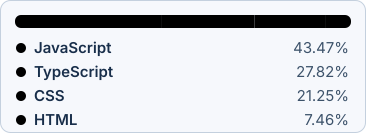

# Nirmik Ukani

**Frontend Developer · React.js Developer**

I build responsive, accessible web interfaces with React.js and JavaScript.

[Portfolio](https://nirmik-portfolio.vercel.app/) · [LinkedIn](https://www.linkedin.com/in/nirmik-ukani-a14a3334b/) · [Contact on Freelancer](https://www.freelancer.in/u/nirmikukani)

## About Me

I turn UI designs into reusable components with attention to accessibility, performance, and maintainable code. I'm deepening my React knowledge, learning TypeScript and Next.js, and improving how I structure frontend applications.

## Technology Stack

  <strong>Programming languages</strong> · JavaScript 
  <strong>Frontend development</strong> · HTML5, CSS3, React.js 
  

  <strong>Styling</strong> · Bootstrap, Tailwind CSS 
  

  <strong>Development tools</strong> · Git, GitHub, VS Code, Vite 
  

  <strong>Currently learning</strong> · TypeScript, Next.js 
  

## Featured Projects

<!-- PROJECTS:START -->

<table>
  <tr>
    <td width="50%" valign="top">
      <h3>ERP Management Frontend</h3>
      
React dashboard for customer records, product listings, inventory and reporting. The frontend prototype uses local and static data.

      
<code>React.js</code> <code>JavaScript</code> <code>CSS3</code> <code>Material UI</code> <code>Recharts</code> <code>Vite</code>

      
JavaScript · 0 stars

      
Code updated 2026-09-23

      
<a href="https://github.com/ukaninirmik65-hash/ERP-App">ERP-App</a> · <a href="https://erp-app-khaki.vercel.app/">Live demo</a>

    </td>
    <td width="50%" valign="top">
      <h3>Atal Kriya 2.0</h3>
      
Employee self-service prototype covering attendance, leave, expenses and map-based field workflows, with simulated login and browser-local data.

      
<code>React.js</code> <code>JavaScript</code> <code>Tailwind CSS</code> <code>React Router</code> <code>Leaflet</code> <code>Vite</code>

      
JavaScript · 0 stars

      
Code updated 2026-10-08

      
<a href="https://github.com/ukaninirmik65-hash/atakKriya-2.O">atakKriya-2.O</a> · <a href="https://atak-kriya-2-o.vercel.app/">Live demo</a>

    </td>
  </tr>
  <tr>
    <td width="50%" valign="top">
      <h3>Tetris Game</h3>
      
Browser-based falling-block game with keyboard controls, line clearing, a next-piece preview, sound effects and local high scores.

      
<code>HTML5</code> <code>CSS3</code> <code>JavaScript</code> <code>Canvas API</code>

      
JavaScript · 1 star

      
Code updated 2026-03-30

      
<a href="https://github.com/ukaninirmik65-hash/Tetris-Game">Tetris-Game</a> · <a href="https://ukaninirmik65-hash.github.io/Tetris-Game/">Live demo</a>

    </td>
    <td width="50%" valign="top">
      <h3>Anita Jewellery</h3>
      
Responsive jewellery storefront showcase with a promotional hero, collection and product layouts, and mobile navigation.

      
<code>HTML5</code> <code>CSS3</code> <code>JavaScript</code>

      
CSS · 0 stars

      
Code updated 2026-05-20

      
<a href="https://github.com/ukaninirmik65-hash/Anitajewellerys">Anitajewellerys</a> · <a href="https://anitajewellerys-k56t.vercel.app/">Live demo</a>

    </td>
  </tr>
  <tr>
    <td width="50%" valign="top">
      <h3>Neelmadhav Public School</h3>
      
School information site with responsive navigation, academic sections, a gallery, event toggles and reduced-motion support.

      
<code>HTML5</code> <code>CSS3</code> <code>JavaScript</code>

      
JavaScript · 0 stars

      
Code updated 2026-08-29

      
<a href="https://github.com/ukaninirmik65-hash/Neelmadhav-Public-School">Neelmadhav-Public-School</a> · <a href="https://neelmadhav-public-school.vercel.app/">Live demo</a>

    </td>
    <td width="50%" valign="top">
      <h3>Personal Portfolio</h3>
      
React portfolio for projects and frontend services, with theme switching, project filtering and a validated inquiry form.

      
<code>React.js</code> <code>JavaScript</code> <code>Tailwind CSS</code> <code>Vite</code>

      
JavaScript · 0 stars

      
Code updated 2026-11-17

      
<a href="https://github.com/ukaninirmik65-hash/nirmik-portfolio">nirmik-portfolio</a> · <a href="https://nirmik-portfolio.vercel.app/">Live demo</a>

    </td>
  </tr>
</table>

<!-- PROJECTS:END -->

## GitHub Analytics

<!-- STATS:START -->

**Public account totals**

| Repos | Stars | Followers |
| ---: | ---: | ---: |
| 9 | 1 | 6 |

**Public contributions** · 2026-01-01 to 2026-11-27 UTC

| Commits | PRs | Profile streak |
| ---: | ---: | ---: |
| 104 | 4 | 2 days |

<!-- STATS:END -->

## Programming Language Distribution

<!-- LANGUAGES:START -->

Based on language bytes in eligible public repositories. [Repository exclusions](docs/SETUP.md#language-distribution)

<!-- LANGUAGES:END -->

## Recent Development Activity

<!-- RECENT_ACTIVITY:START -->

- [Add Quality Assurance page with routing and styles](<https://github.com/DhruvilPatel121/Construction_Web/commit/fb76392fd35ad8dbb5995c255f7373b95f61fa80>) · Commit · DhruvilPatel121/Construction&#95;Web · 2026-11-24
- [Refactor App component to use centralized routing and remove redundant code](<https://github.com/DhruvilPatel121/Construction_Web/commit/60ebb1aef68d75f1e082c00a08e261c65e3e8146>) · Commit · DhruvilPatel121/Construction&#95;Web · 2026-11-20
- [Implement centralized routing with React Router and add Certificates page](<https://github.com/DhruvilPatel121/Construction_Web/commit/c00dd0ddc87249548ef6b7d11d6fbe8bc1b2a011>) · Commit · DhruvilPatel121/Construction&#95;Web · 2026-11-20
- [Add Awards page with reusable media wipe and update routing](<https://github.com/DhruvilPatel121/Construction_Web/commit/2562ddf9ad316e87a3cbefe05ee67f23eaac7372>) · Commit · DhruvilPatel121/Construction&#95;Web · 2026-11-20
- [Implement reusable PageBanner component and standardize inner-page banners across About and Achievements pages](<https://github.com/DhruvilPatel121/Construction_Web/commit/eebdd6904974f08965f69ba3ef053f8563c8dcd4>) · Commit · DhruvilPatel121/Construction&#95;Web · 2026-11-19

<!-- RECENT_ACTIVITY:END -->

## Professional Experience

**Frontend development · 1+ year of hands-on experience**

My work includes implementing UI designs, building reusable React components, adding interactive browser features, and refining layouts across screen sizes.

## Connect With Me

[Portfolio](https://nirmik-portfolio.vercel.app/) · [LinkedIn](https://www.linkedin.com/in/nirmik-ukani-a14a3334b/) · [Freelancer](https://www.freelancer.in/u/nirmikukani) · [GitHub](https://github.com/ukaninirmik65-hash)

**Freelance services** · Responsive websites, landing pages, React.js frontends, website redesigns, UI improvements, JavaScript development, and frontend bug fixes.

## Last Successful Data Update

<!-- LAST_UPDATED:START -->

**2026-11-27 13:53 UTC** · Last complete data update.

<!-- LAST_UPDATED:END -->

[Data sources and refresh schedule](docs/SETUP.md) · [Project verification](docs/PROJECT-VERIFICATION.md)
